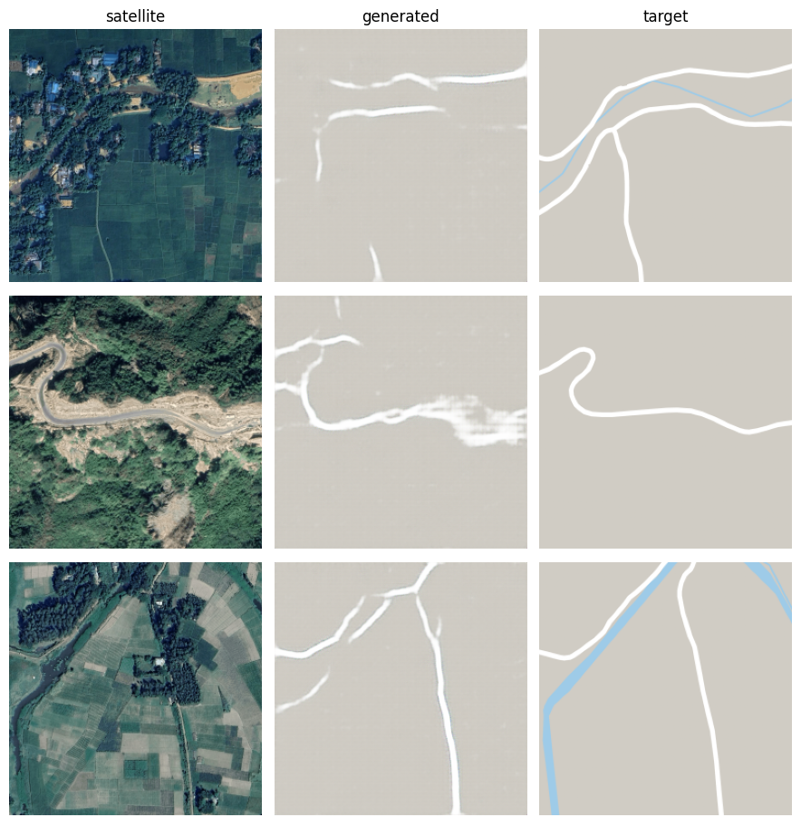

# Road map generation from satellite imagery of rural Bangladesh

Code for the B.Sc. thesis *"A Transformer-GAN Based Map Generation for Rural Roads of Bangladesh
from Satellite Imagery"* (Department of CSE, KUET, 2025).

Rural road maps are often incomplete because the roads are narrow, irregular and slow to
survey. This project builds a paired satellite/map dataset of 3,000 rural tiles sampled across
Bangladesh, then trains Pix2Pix-style generators to draw the road map directly from the
satellite tile. The code covers:

- **U-Net** (the Pix2Pix baseline)
- **U-Net + transformer block**, placed either at the 1x1 bottleneck or at the 8x8 stage after encoder block e5
- **Attention U-Net** (gated skip connections)
- **ResNet-9** (the CycleGAN generator)
- **Segmentation formulation:** the same backbones with a three-class softmax head (background, road, water)

All of them are trained against a 70x70 PatchGAN discriminator, and every model is scored
with the same evaluation protocol.


<sub>Imagery and map data © Google.</sub>

## Repository layout

```
sat2map/                         importable package
  models.py                      generators, transformer block, PatchGAN discriminator
  data.py                        tf.data pipeline for the concatenated satellite|map PNGs
  training.py                    road-weighted L1 + adversarial loss, train step
  segmentation.py                label construction, Dice + weighted cross-entropy
  evaluation.py                  evaluation protocol (TTA, validation threshold, metrics, bootstrap)
  runs.py                        run naming and checkpoint discovery
notebooks/
  01_train.ipynb                 train one image-formulation configuration
  01b_train_segmentation.ipynb   train one segmentation-formulation configuration
  02_evaluate.ipynb              score every checkpoint, aggregate over seeds, paired tests
  03_ablations.ipynb             loss-weight and input-resolution ablations
data_collection/
  build_town_list.py             urban exclusion list from GeoNames
  fetch_rural_pairs.py           rural sampling + paired tile download (Google Maps Static API)
  split_dataset.py               seeded 80/10/10 split into train/ val/ test/
  zoom_test.py                   zoom-level sweep (used to pick zoom 18)
  zoom_road_stats.py             road-fraction statistics for the zoom sweep
  check_fullres.py               how much detail survives downsampling to 256 px
```

## Dataset

The dataset is **not included**, because Google Maps imagery cannot be redistributed. These
scripts rebuild it with your own Maps Static API key:

```bash
cd data_collection
python build_town_list.py      # towns_bd.csv from GeoNames
python fetch_rural_pairs.py    # set API_KEY; run once with PREVIEW_ONLY = True
python split_dataset.py        # train/ val/ test/ (2400 / 300 / 300), seed 1907096
```

The split lands in `data_collection/rural_dataset/rural_z18_s512/{train,val,test}/`. Move it to
`data/Dataset/` or set `DATA_ROOT` in the notebooks to point there.

How the tiles are chosen:

- **Where:** points are sampled uniformly inside the Bangladesh boundary
  ([geoBoundaries](https://www.geoboundaries.org/)), shrunk 3 km inward so no tile crosses the border.
- **Away from towns:** points near any town of 20,000+ people
  ([GeoNames](https://www.geonames.org/), CC BY 4.0) are rejected. The exclusion radius grows
  with √population, from 3 km to 25 km.
- **Scale and overlap:** tiles are taken at zoom 18 and snapped to a ~320 m grid, so no two
  tiles overlap.
- **Map styling:** the map half uses a forced palette with labels, POIs, transit and borders
  turned off. Land and water are each one flat colour, and roads are pure white, so road
  pixels can be found with an exact colour test.
- **Rejected tiles:** a tile is dropped if its map has less than 0.4% road or its satellite
  half is nearly flat (water or cloud).
- **Storage:** each pair is saved as one 1024x512 PNG, satellite on the left and map on the
  right, and is downsampled to 256 at load time.

## Installation

```bash
git clone <this repository>
cd sat2map-rural-bd
pip install -e .
```

This installs the `sat2map` package and its dependencies (TensorFlow 2.16+ with Keras 3, NumPy,
OpenCV, SciPy, Matplotlib). The thesis runs used TensorFlow 2.20 on a GPU. The data collection
scripts also need `requests` (`pip install -e ".[collect]"`).

## Usage

Paths are set in the config cell of each notebook. By default they expect the dataset at
`data/Dataset/` and write runs to `runs/`, relative to the repository root.

1. **Train.** Open `01_train.ipynb` (or `01b_train_segmentation.ipynb`), choose `ARCH` and the
   other settings in `CFG`, then Run All. Each run saves
   `<OUT_ROOT>/<run name>/generator_best.weights.h5`. A table at the top of `01_train.ipynb`
   lists the configurations used in the thesis.
2. **Evaluate.** Point `CKPT_ROOT` in `02_evaluate.ipynb` at the folder that holds the run
   folders, then Run All. It writes `final_eval.csv`, per-tile scores, the per-architecture
   summary, paired comparisons and figures. `03_ablations.ipynb` does the same for the
   single-seed ablation runs.

Training settings: 256x256 input, batch 4, Adam (lr 2e-4, β1 0.5), 30 epochs, horizontal
flips. The image formulation uses an L1 loss with weight 100, with road pixels weighted 11×,
plus an adversarial term with weight 0.3. The segmentation formulation uses soft Dice plus
class-weighted cross-entropy. In both cases the checkpoint with the best validation buffered
IoU is kept.

Evaluation protocol: the road score is averaged over four flips (test-time augmentation). The
threshold is chosen per model on the validation split and then frozen, and a 3x3 closing is
applied. The test split is scored once at 256x256 with:

- buffered IoU (2 px tolerance)
- strict IoU
- relaxed precision and recall
- the ratio of predicted to true road

Models are compared tile by tile against the U-Net, with a bootstrap 95% interval and a
Wilcoxon signed-rank test.

## Citation

```bibtex
@thesis{nihal2025sat2map,
  author = {Akib Mahmud Nihal},
  title  = {A Transformer-GAN Based Map Generation for Rural Roads of Bangladesh from Satellite Imagery},
  school = {Khulna University of Engineering \& Technology},
  type   = {B.Sc. thesis},
  year   = {2025}
}
```

Supervised by Dr. Sk. Md. Masudul Ahsan, Department of CSE, KUET.

## Acknowledgements

The U-Net generator and PatchGAN discriminator follow Pix2Pix (Isola et al.). The baselines
follow the CycleGAN ResNet generator (Zhu et al.; Johnson et al.) and the Attention U-Net
(Oktay et al.). The country boundary comes from geoBoundaries and the town list from GeoNames.

## License

MIT for the code (see `LICENSE`). Imagery and map tiles belong to Google and its data providers.
